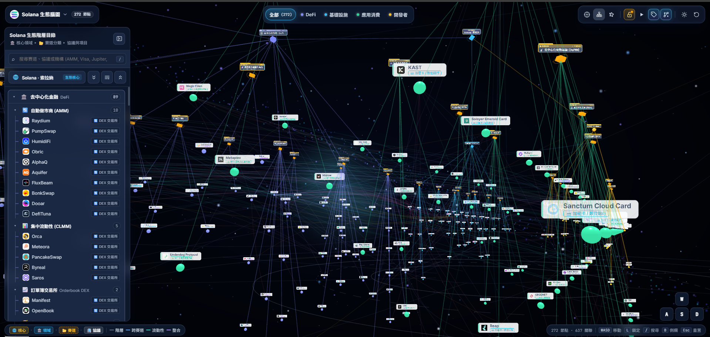
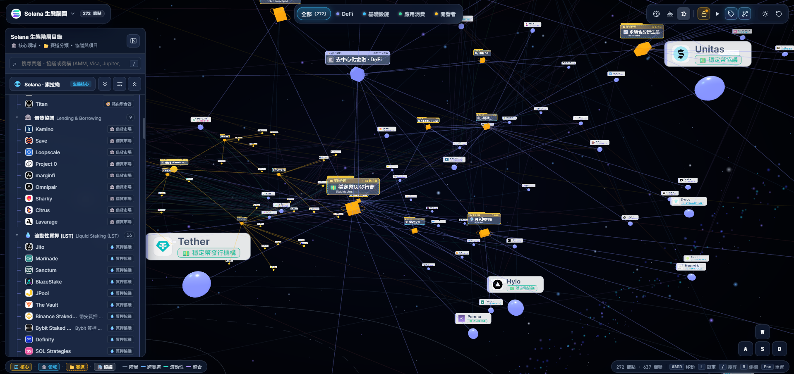
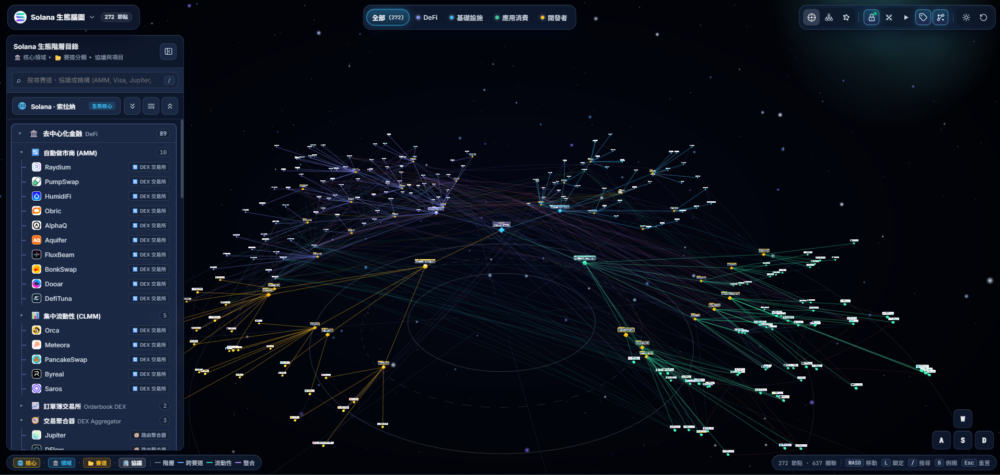
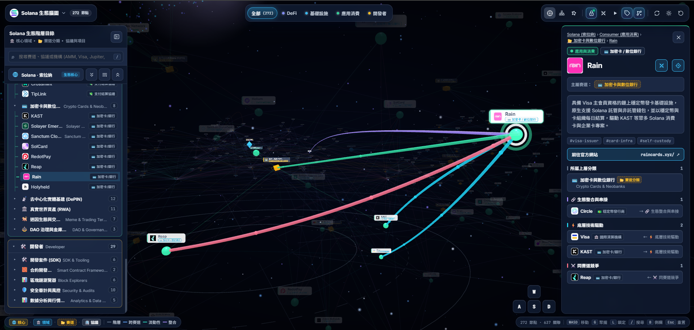
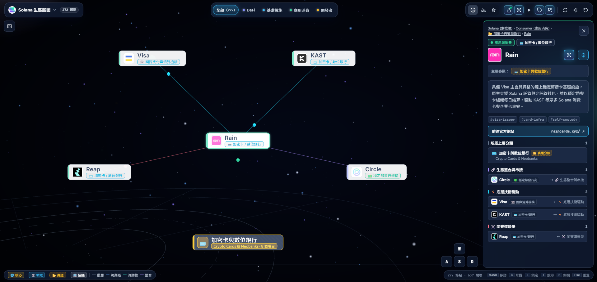

# Solana 與 EVM 的 3D 生態知識腦圖



這張是打開後的主畫面。左側目錄停在去中心化金融，中間星空裡是一張張專案名片，以及把它們連起來的線。

## 這是什麼

這是一個用瀏覽器打開的立體知識地圖。它把 **Solana** 與 **EVM** 兩條鏈上的專案、分類，以及專案之間的關係，畫成可以走近、點開的 3D 腦圖。不用先懂程式。電腦用滑鼠點、用鍵盤移動；手機用手指轉、點右下角的方向鍵，也可以加到主畫面，像 App 一樣打開。

線上版在 GitHub Pages：

**https://wing9897.github.io/cryp3d-eco/**

用瀏覽器打開這個網址即可。不用安裝，也不用下載專案。

地圖上的內容來自專案裡的資料：Solana 放在 `data`，EVM 放在 `data/evm`。可以看的領域有去中心化金融（DeFi）、中心化金融、基礎設施、應用與消費、開發者工具。

## 畫面結構

畫面分成四塊：

- **頂欄**：左上角是目前這條鏈的名稱和節點數，點下去可以換鏈。中間是領域篩選。右邊是排版、聚攏、更新 Logo、深淺色與重置視角。
- **左側目錄**：依領域、分類、專案往下展開，也可以打字搜尋。
- **3D 腦圖**：佔滿中間。深色星空裡，每個節點是一張名片，線代表關係。
- **右側詳情**：點選某個節點後才出現，裡面有中文說明、官網，以及跟它相連的項目。



左側目錄展開時，可以順著分類往下找，例如穩定幣與借貸；畫面上會看到 Tether、Hylo、Unitas 這類名片。



把鏡頭拉遠，節點會沿著地面的圓環散開，方便一次看到很多分類。



點一個節點後，右側會打開它的說明，跟它有關的連線也會用不同顏色標出來。

## 怎麼操作

- **點節點**：在中間點名片，或在左側目錄點名稱。右側會打開這個節點的詳情。
- **聚攏**：先選好一個節點，按鍵盤 **G**，或點頂欄的聚攏按鈕。跟它直接有關的名片會收到它四周。
- **還原**：再按一次 **G**，或點同一個按鈕（這時提示是「還原節點原位」），名片回到原來的位置。按 **Esc** 也會退出聚攏。
- **前後左右**：鍵盤 **W** 往前、**A** 往左、**S** 往後、**D** 往右。
- **上下**：**空白鍵**往上，**C** 往下。畫面右下角也有同一組方向鍵，按住就能移動。
- **換鏈**：點左上角標題。可以在 Solana 生態腦圖與 EVM 生態腦圖之間切換。選了 EVM 之後，還可以再看 Ethereum、BNB Chain、Base、Arbitrum，或看全部 EVM 鏈。
- **換領域**：點頂欄中間的領域，或在左側目錄展開。領域有 DeFi、中心化金融（CeFi）、基礎設施、應用消費、開發者。點「全部」會回到整張圖。

頂欄另外還有三種排法（放射腦圖、樹狀階層、自由網路）、鎖定或解開節點拖曳、自動巡覽、顯示名稱、跨領域連線、深色或淺色，以及「重置視角與篩選」。節點預設是鎖住的，避免不小心拖動；點下去看詳情仍然可以。

## 平面聚攏

按 **G** 之後，畫面變成一張平面腦圖。選中的名片留在中間，直接相連的名片排成一圈又一圈的同心圓。名片用同一高度、同一字級，不會因為是分類或專案就放大縮小。沒有直接關係的節點會退到後面，幾乎看不見。



以 Rain 為例，聚攏後 Visa、KAST、Circle、Reap 和它所屬的分類會圍在四周，右側詳情仍然開著。

## Logo

專案圖示放在 `cache/logos/`。名片上的小圖，以及頂欄的鏈圖示，都是讀這個資料夾。圖示舊了或還沒出現時，點頂欄的 **更新 Logo**，程式會依目前畫面上的專案再抓一次，並寫回這個資料夾。抓不到時，畫面上仍保留已經存好的圖。

## 手機上怎麼用

手機畫面把目錄和說明改成從下方升起的面板，避免擋住整張圖。

- **轉鏡頭**：一根手指在星空上拖。兩根手指可以放大、縮小。
- **移動**：按住右下角的「前、後、左、右、上、下」。
- **目錄**：點左下角的「目錄」，從下方挑專案。點到一個名字後，目錄會收起。
- **說明**：點星空裡的名片，說明從下方升起。再點空白處，或點右上角關閉。
- **換領域、換鏈、工具**：領域在最上方可以左右滑。點右上角「工具」可以換排法、聚攏、深淺色和重置。

手機上預設先看圖，名稱先隱藏，需要時再到「工具」裡打開「顯示名稱」。

## 加到主畫面

這個網站可以裝成一個小 App（PWA）。裝好之後，主畫面會有「生態腦圖」圖示，打開時不再顯示瀏覽器網址列。曾經打開過的畫面，沒有網路時也能再看。

- **Android（Chrome）**：打開網站後，若下方出現「安裝」，點下去即可。也可以用瀏覽器選單裡的「加到主畫面」或「安裝應用程式」。
- **iPhone（Safari）**：點下方的分享按鈕，再點「加入主畫面」。請用 Safari，其他瀏覽器沒有這個選項。

本機要確認能不能安裝，請先執行 `npm run build`，再執行 `npm run preview`，用瀏覽器打開終端機印出的網址。開發用的 `npm run dev` 只看版面，不會註冊離線快取。

## 在自己的電腦打開

先安裝 [Node.js](https://nodejs.org/)，這樣才有 `npm` 指令。接著在這個專案資料夾開啟終端機（PowerShell 或命令提示字元都可以），依序執行：

```bash
npm install
npm run dev
```

第一行會安裝這個網頁需要的套件，做一次即可；套件有變時再做一次。第二行會啟動本機預覽。終端機會印出網址，用瀏覽器打開即可，通常是 `http://localhost:5173`。

看完後，在同一個終端機按 `Ctrl` + `C` 即可停止。
